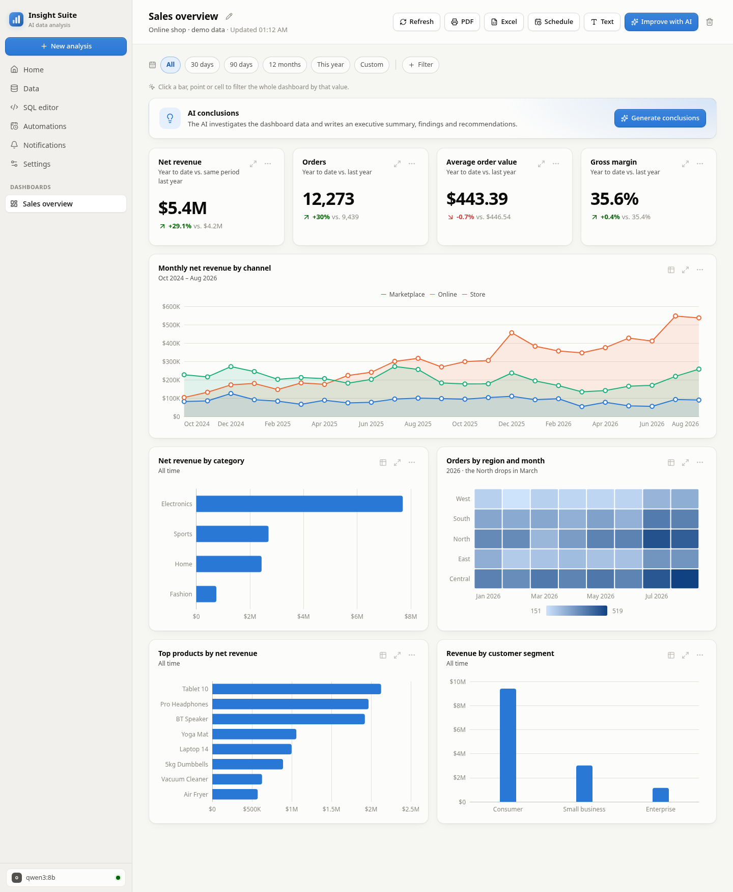
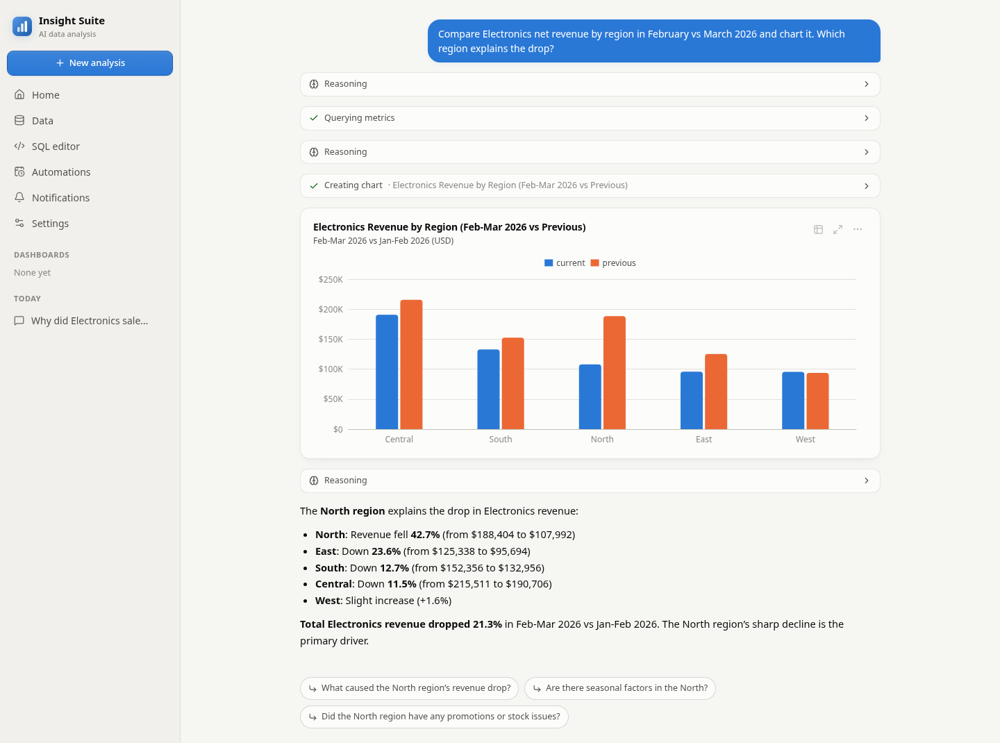
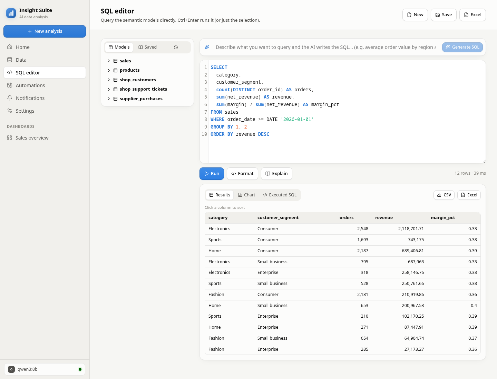
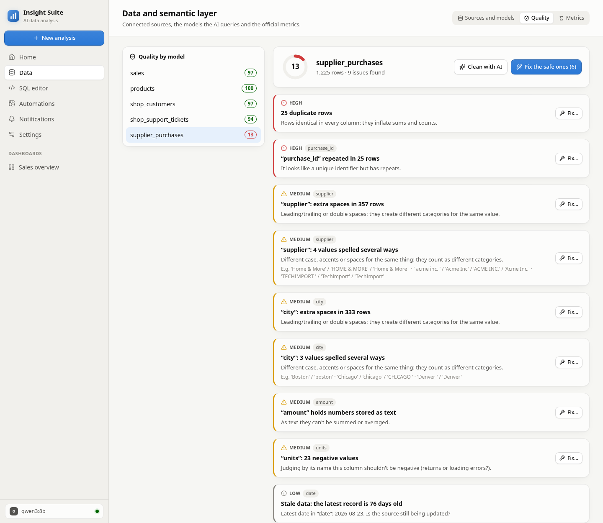

# Insight Suite

An AI data analyst you run on your own machine. Connect files or databases, ask questions in
plain language, and an agent queries the data through a semantic layer, builds charts and
dashboards, writes up its findings, cleans messy data and watches your metrics.

It works with Claude, OpenAI, Gemini, OpenRouter, DeepSeek, Groq, Mistral, Ollama, LM Studio or
any OpenAI-compatible API.





*The chat running on a local model (`qwen3:8b` through Ollama, no API key). It found the right
region, though it compared Feb–Mar against Jan–Feb instead of February against March: the tool
steps and the chart subtitle make that visible.*

FastAPI + DuckDB backend, React + TypeScript + ECharts frontend. About 5k lines of Python and
4.6k of TypeScript, with 28 backend tests.

## Architecture

```
Files (CSV, Excel, Parquet, JSON) ─┐
Postgres / MySQL / SQLite (live) ──┤
Google Sheets / URLs (reloaded) ───┤
                                   ▼
                      DuckDB  (single analytical engine)
                                   │
              Semantic layer  (wren-core from Wren AI, Apache 2.0)
              models · relationships · calculated fields · validation
                                   │
   Agent (Claude / OpenAI / Gemini / Ollama / …) ── tools: describe_model, run_query,
                                   │                 query_metrics, create_chart,
                                   │                 create_dashboard, check_data_quality,
                                   │                 create_alert, … (22, plus run_python)
           ┌───────────────────────┼─────────────────────────┐
     REST API + SSE           MCP server (/mcp)       Versionable JSON files
     (FastAPI)                Claude Code / Desktop   (charts, dashboards, MDL)
           │
     Web interface (React + ECharts)
```

Key decisions:

- **DuckDB as the only engine.** Files are imported as tables and databases are attached live,
  so a single query can join a CSV with a Postgres table.
- **A semantic layer between the AI and the tables.** The AI writes SQL against *models*, not
  physical tables. Wren expands relationships and calculated fields (e.g. `net_revenue`, or
  `category` through `products.category`), and every change to the layer is validated before it's
  saved. All access goes through `backend/app/semantic.py`, so the engine could be swapped
  (Cube, a custom one) without touching the rest.
- **The AI produces specifications, not chart code.** `create_chart` takes a small `ChartSpec`
  (type, SQL, x, y, series, format). The frontend draws it with one design system: a
  colorblind-safe palette, dark mode, a single Y axis and consistent tooltips. Charts and
  dashboards are stored as editable JSON and re-run against fresh data.
- **Read-only.** Only `SELECT` statements run (checked by sqlglot and by Wren), and databases are
  attached `READ_ONLY`.

## AI providers

Set them up in **Settings** (key, model, base URL, a *Test* button) or in `.env`. The model picker
in the chat changes the model for new conversations; each conversation keeps the model it started
with, and switching mid-conversation hands the new model a transcript of what happened so far.

| Provider | Adapter | Notes |
|---|---|---|
| Anthropic (Claude) | Native API | Adaptive thinking, server-side fallbacks, prompt caching |
| OpenAI, Gemini, OpenRouter, DeepSeek, Groq, Mistral | Chat Completions-compatible | `reasoning_effort` on OpenAI and Gemini |
| Ollama, LM Studio, your own endpoint | Chat Completions-compatible | Local, no key. The model must support tool calling |

Everything lives in `backend/app/providers.py`: adding another compatible provider is one line in
`PRESETS`.

## How the AI designs dashboards

1. **Column roles.** The semantic layer tags each column as time (with its range), measure,
   dimension (with its cardinality), identifier or label, from real statistics on the data
   (`semantic.py`). The agent sees those roles in its prompt.
2. **Kind of data → layout.** The analyst prompt (`agent.py`) has a playbook per kind of data:
   - *Transactional with a date:* KPIs with a period comparison, trend, breakdown, mix, top-N and
     an anomaly heatmap.
   - *Entities/customers:* segments, concentration and rankings.
   - *Operations:* volumes, p50/p90 times and reasons.
   - *Financial:* margins and deviations.
   - *No date:* distributions and detail.

   It also covers time granularity for the range and the layout (2-4 KPIs, one full-width main
   chart, 5-9 charts in total).
3. **Conclusions.** After building a dashboard, the AI investigates (compares periods and breaks
   down by dimension until it finds causes) and saves an **executive summary, quantified findings**
   (positive, negative, warning or key fact, each linked to its chart) and **recommendations**.
   They can be regenerated from the dashboard for the active filters, and copied as Markdown.

## Official metrics

In **Data → Metrics** (or by asking the AI) you define named aggregate metrics, such as
`avg_order_value = sum(net_revenue) / count(DISTINCT order_id)`. They're validated against the
data when saved, can be marked *certified*, and the AI uses them instead of inventing formulas.

The `query_metrics` tool (also `POST /api/metrics/query`) supports:

- **Periods relative to the latest data point:** last 7/30/90 days, last 12 months, month/quarter/
  year to date, and the last full month/quarter/year.
- **Comparisons:** year over year; against the previous calendar period (the last full month
  against the month before, year to date against the same days last year); and, with a grain,
  period over period per dimension.

## Automations: alerts and reports

From the **Automations** page, or from the chat ("let me know if…", "send me this dashboard every
Monday"):

- **Alerts** on an official metric, with a period, filters (e.g. only *Meta Ads*) and a condition
  (% change against the previous period or year, or an absolute value). The form shows live
  whether it would fire today. When an alert fires, the AI investigates the cause and adds it to
  the notification.
- **Scheduled reports** of a dashboard: KPIs, conclusions regenerated by the AI, and
  recommendations.
- **Channels:** the in-app **Notifications** inbox (always on), SMTP email, Slack (incoming
  webhook) and a generic webhook (Teams, n8n, Zapier…). Set up in Settings → Notifications, with a
  test button; secrets are stored encrypted.
- **Runs** come from a scheduler inside the backend that checks every 30 seconds (local time), so
  the backend has to be running.

## SQL editor



For people who'd rather write the queries:

- CodeMirror with highlighting and autocomplete of models and columns; Ctrl+Enter runs the whole
  query or just the selection. Side panel with the model tree, saved queries and history.
- AI assistant: **Generate SQL** from a description, **Fix with AI** when a query fails, and
  **Explain** a query in business terms. Generated SQL is run before it's returned, so a query
  with a column that doesn't exist goes back to the model with the error.
- Results sort by column, turn into a chart (visual builder → save → add to a dashboard), and the
  *Executed SQL* tab shows what the semantic layer actually ran.
- Any query from the chat or chart from a dashboard opens in the editor with one click, and the
  AI can save queries ("save this query").
- **Excel export** of a query (real dates, column filters, frozen header), of any chart (with its
  currency or percent format) or of a whole dashboard (a summary sheet with the conclusions plus
  one sheet per chart, for the active filters).

## Interactive dashboards

- **Click to filter.** Clicking a bar, point or cell filters the whole dashboard. The backend
  translates the click with sqlglot: a truncated month (`date_trunc('month', order_date) AS
  month`) becomes that month's date range, and an alias (`customer_country AS country`) its real
  column. It also works on metric queries with CTEs, and on charts with series or heatmaps it
  applies both filters at once (e.g. March + North).
- **Targets and budgets** are drawn as a reference line on bars and lines, and as a progress bar
  on a KPI ("88 % of the annual target").
- **Annotations** mark events on the X axis ("Stockout") with a vertical line.
- **Text blocks and sections** (markdown), edited with a double click; cards reorder by dragging.
- The AI uses all of these too (`add_text_block`, `update_dashboard_chart`).

## Data quality and preparation



In **Data → Quality**:

- **An automatic check** per model with a 0-100 score: exact duplicates and repeated keys, blanks
  and extra spaces, the same category spelled several ways ("Chicago", "chicago ", "CHICAGO"),
  numbers or dates stored as text (including `1.234,56` and `dd/mm/yyyy`), negatives where they
  make no sense, outliers, future dates and stale data.
- **Fixes with a preview:** the rows that change, before/after examples, and a warning if any
  value would end up blank. **Fix the safe ones** applies, in bulk, everything that needs no
  business judgment; the rest (filtering rows, filling blanks) is previewed and confirmed.
- **Reversible recipes:** the original data is never modified. The steps are materialized as a
  view in `workspace.prep.<model>` and the semantic model reads from it under the same name, so
  dashboards, metrics and alerts keep working. It works the same for read-only remote databases.
  Removing a step undoes it.
- **Cleanup with AI:** the agent checks (`check_data_quality`), applies the safe fixes
  (`add_cleaning_step`) and asks about the rest.
- **Google Sheets and URLs:** paste the link of a sheet shared by link (or of a published
  CSV/Excel/Parquet file) and choose how often to reload it: 15 min, 1 h, 6 h or 1 day. Cleanup
  recipes are reapplied after every reload.

## Getting started

Requirements: Python 3.11-3.12 with [uv](https://docs.astral.sh/uv/), Node 20+ and (optionally)
Docker for the demo databases.

```bash
cp .env.example .env            # optional: API keys and the starting provider (or set them in Settings)
./scripts/dev.sh                # backend on :8000 + frontend with hot reload on :5173
```

Open http://localhost:5173.

Single-process "production" mode: `cd frontend && npm run build`, then
`cd backend && .venv/bin/uvicorn app.main:app --port 8000`. The interface is at
http://localhost:8000.

To use a local model, install [Ollama](https://ollama.com), pull a model with tool calling
(e.g. `ollama pull qwen3:8b`) and set `INSIGHT_PROVIDER=ollama`, or pick it in Settings.

### Demo data

```bash
cd backend
uv run python ../scripts/generate_demo.py   # writes demo/: sales.csv, products.xlsx, supplier_purchases.csv and the Postgres SQL
cd .. && docker compose up -d               # demo Postgres on localhost:5442 and MySQL on :3316 (user demo/demo)
backend/.venv/bin/python scripts/load_demo.py   # with the suite running: loads everything and seeds the semantic layer and metrics
```

The data is synthetic (a fixed random seed) and has patterns the agent should find:

- Christmas seasonality.
- The online channel growing over time.
- Electronics almost disappearing in the North region in March 2026 (a stockout).

Try asking: *"Why did Electronics sales drop in March 2026?"*

`demo/supplier_purchases.csv` has errors on purpose for the quality check (it starts at 13/100).

## Connecting databases

In **Data → Connect a database**: pick PostgreSQL (and compatibles such as Supabase, Neon,
Timescale or Cockroach), MySQL/MariaDB or SQLite, fill in the fields or paste a connection string,
**Test connection**, choose the schemas and connect. A `.sqlite`/`.db` file can also be dropped on
the upload area.

- **Always read-only.** DuckDB attaches the database `READ_ONLY` and the suite only runs `SELECT`.
  A read-only user is still recommended; the **?** button in the form shows the SQL to create one.
- **Encrypted secrets.** Passwords and API keys are stored encrypted with Fernet in
  `sources.json` and `settings.json`. The key lives in `workspace/.secret.key` or
  `INSIGHT_SECRET_KEY`. That protects against leaking those files, not against someone with
  access to your user account. Connection errors never show the password.
- **Network.** This machine has to reach the server: in the cloud, add your IP to the allow list
  and turn on SSL; on private networks, use a VPN or an SSH tunnel.
- **Performance.** Queries go live to the database. With tables of tens of millions of rows, point
  it at a read replica.
- On MySQL, the DuckDB extension's aggregate pushdown is turned off because of a bug with
  `COUNT(*)` over subqueries.

## Using it from Claude Code (MCP)

With the backend running:

```bash
claude mcp add --transport http insight-suite http://localhost:8000/mcp/
```

It exposes the same tools as the chat agent, plus `semantic_layer` (queries, metrics, charts, dashboards,
data quality, automations). Whatever gets created over MCP shows up in the web interface.

## Configuration (`.env`)

| Variable | Default | What it does |
|---|---|---|
| `ANTHROPIC_API_KEY`, `OPENAI_API_KEY`, `GEMINI_API_KEY`, … | — | Keys per provider (also settable in Settings) |
| `INSIGHT_PROVIDER` | `anthropic` | Provider the app starts with (`ollama`, `openai`, …) |
| `INSIGHT_MODEL` | `claude-opus-5` | Default Claude model |
| `INSIGHT_EFFORT` | `high` | Reasoning depth (`low` … `max`) |
| `INSIGHT_ENABLE_PYTHON` | `false` | The `run_python` tool. It runs in a local subprocess **without isolation** |
| `INSIGHT_PUBLIC_URL` | `http://127.0.0.1:8000` | Base URL for the links in notifications |
| `INSIGHT_SECRET_KEY` | generated | Encryption key for stored secrets |
| `INSIGHT_WORKSPACE_DIR` | `./workspace` | Where data, semantic layer, charts, dashboards and conversations are stored |

## Project structure

```
backend/app/
  workspace.py    DuckDB: file import, database attach, profiling, safe execution
  semantic.py     semantic layer (Wren): model sync, relationships, calculated fields, column roles
  charts.py       ChartSpec / Dashboard and their JSON storage
  tools.py        agent tools (shared with MCP)
  providers.py    AI providers (native Anthropic + OpenAI-compatible adapter) and settings
  agent.py        the analyst loop, independent of the provider
  metrics.py      official metrics and the period/comparison compiler
  dataprep.py     quality check, reversible cleanup recipes, URL sources
  automation.py   alerts, scheduled reports and delivery channels
  filters.py      global dashboard filters and click-to-filter (safe SQL rewriting with sqlglot)
  sqlwork.py      SQL editor: saved queries, AI assistant, Excel export
  mcp_server.py   MCP server mounted at /mcp
  main.py         REST API + SSE
frontend/src/
  views/          Home, Chat, Dashboard, Data, SQL editor, Automations, Notifications, Settings
  components/     Chart (ECharts), ChartCard, Composer, ModelPicker, QualityPanel, MetricsPanel…
scripts/          dev.sh, generate_demo.py, load_demo.py
workspace/        local state (ignored by git)
```

## Tests

```bash
cd backend
uv run python ../scripts/generate_demo.py   # the tests use the demo files
uv run pytest -q
```

They cover the agent loop against a simulated Claude and a simulated OpenAI-compatible server,
the read-only guard, dashboard filters (including an injection test), click-to-filter, metric
periods and comparisons, alerts and report delivery to a local webhook, data quality and cleanup
recipes, URL sources, Excel export and the secret vault. The MySQL test runs only when the demo
MySQL is up.

## Limitations

- Single user, no login: it's meant to run on your machine or a trusted network.
- `run_python` has no sandbox, which is why it's off by default.
- Local models need solid tool calling to work as the analyst; small models do simple questions
  better than whole dashboards.
- The screenshots use the synthetic demo data. The dashboard in them was assembled through the
  API, and its AI conclusions haven't been generated; the chat screenshot is a real run on a
  local 8B model.

## License

MIT
